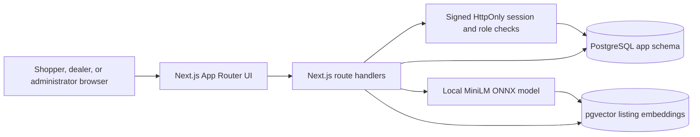
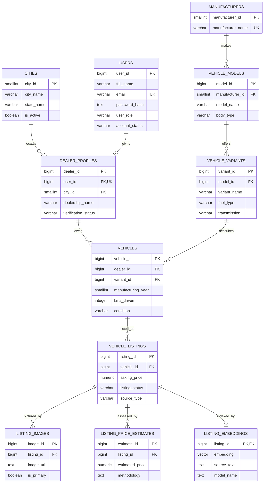

# AutoHubIQ architecture and demo guide

## Application architecture

Public marketplace requests read active listings from PostgreSQL. Semantic
search embeds the user's query locally, then ranks listing embeddings in
PostgreSQL with cosine distance and applies city, budget, fuel, and transmission
filters in SQL. Dealer publishing creates the vehicle, listing, and embedding
within one database transaction. Seller and admin APIs authenticate the
HttpOnly signed session and re-check the current account role and status from
the database.

## Entity relationship diagram

## Data dictionary

| Table | Purpose | Important rules |
| --- | --- | --- |
| `app.cities` | Supported marketplace locations | City and state are unique together; inactive cities cannot be selected for new dealer registration. |
| `app.users` | Customer, dealer, and admin accounts | Email is unique case-insensitively; roles are `customer`, `dealer`, or `admin`; account state is `active`, `suspended`, or `pending`. |
| `app.dealer_profiles` | Dealer business profile and verification | One profile per user; linked to a city; verification is `pending`, `verified`, or `rejected`. |
| `app.manufacturers` | Vehicle makes | Manufacturer name is unique. |
| `app.vehicle_models` | Manufacturer-specific models | Model name is unique per manufacturer; body type is constrained to the catalogue. |
| `app.vehicle_variants` | Fuel/transmission/trim catalogue | Variant name is unique per model; fuel type, transmission, and seating are constrained. |
| `app.vehicles` | Physical car details and dealer ownership | References an owning dealer and catalogue variant; years, mileage, ownership count, and condition are checked. |
| `app.vehicle_listings` | Asking price, description, and sale status | Asking price must be positive; status is constrained; a partial unique index allows at most one active listing per vehicle. |
| `app.listing_images` | Listing image URLs and display order | Images are associated with a listing; deleting a listing cascades to its images. |
| `app.listing_price_estimates` | Market estimate and its methodology/source note | Estimate is separate from seller asking price; one listing can have multiple dated estimates. |
| `app.listing_embeddings` | Semantic-search vector and embedding source | One 384-dimensional vector per listing; listing deletion cascades to its embedding. |

Two views expose active listing details and dealer inventory summaries. The
`app.search_active_listings` function provides structured city, price, fuel,
and transmission filtering. `app.set_updated_at()` triggers maintain update
timestamps on mutable profile, vehicle, and listing rows.

## Suggested classroom demonstration

1. Open the marketplace, choose a city, inspect an active listing, and compare
   the seller's asking price with the separate indicative estimate.
2. Search with a natural-language request and a city/budget filter; show the
   semantic result and its structured listing details.
3. Register a dealer account. Show that its initial state is pending and that
   publishing controls are unavailable.
4. Sign in as a pre-provisioned administrator, review the dealership details,
   and verify the dealer.
5. Sign in as the dealer, publish a catalogue-backed vehicle, update its price
   or status, then show that the new active listing is available on the public
   marketplace and in semantic search.
6. Reject a verified dealership in a test environment and show that its active
   listings are withdrawn rather than deleted.

Admin access is deliberately not available through public registration. For a
demo, a trusted database operator must provision an administrator account
beforehand. Use a dedicated test database for this walkthrough; do not use
seed demo account placeholders as passwords.
