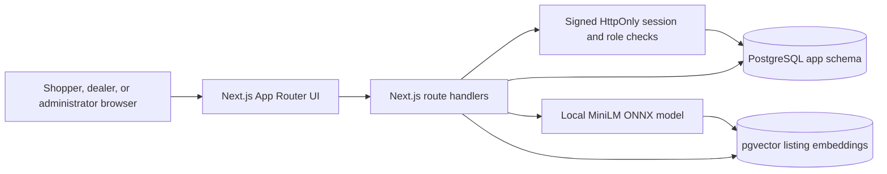
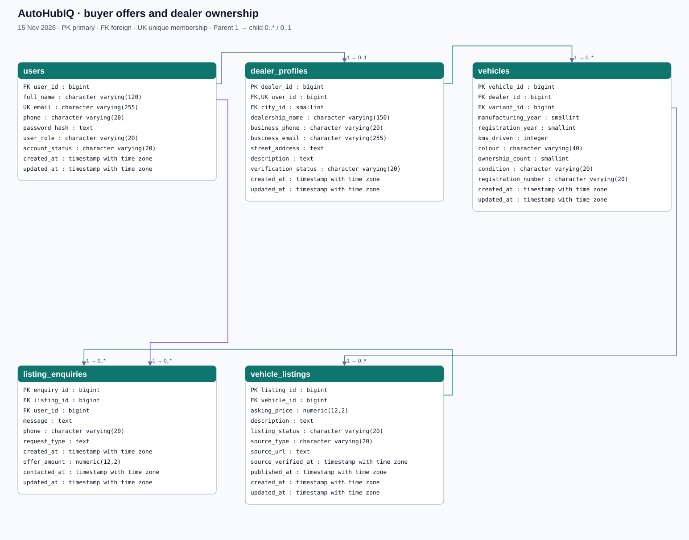
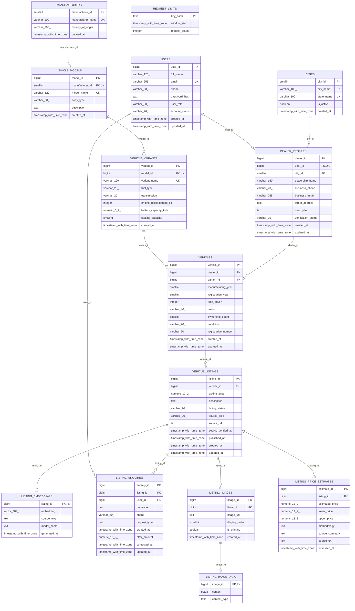

# AutoHubIQ architecture and demo guide

## Application architecture

The vector node above represents a table inside the same PostgreSQL database,
not a separate service. Next.js Route Handlers implement the backend; the
backend directory is not a separate running application.

Public marketplace requests read active listings from PostgreSQL. Semantic
search embeds the user's query locally, then ranks listing embeddings in
PostgreSQL with cosine distance and applies city, budget, fuel, and transmission
filters in SQL. Dealer publishing creates the vehicle, listing, and embedding
within one database transaction. Seller and admin APIs authenticate the
HttpOnly signed session and re-check the current account role and status from
the database.

## Entity relationship diagrams

Audited against all 14 live base tables and a fresh SQL install on 15 November 2026.
The complete physical diagram includes every column. Offers are rows in
listing_enquiries, not a separate bids table. request_limits is independent
and has no FK. PK/FK/UK denote key membership; composite unique definitions,
nullability and deletion behavior are specified in the dictionary.

- [Complete ERD (SVG)](diagrams/erd-complete.svg) · [Mermaid source](diagrams/erd-complete.mmd)
- [Marketplace ERD (SVG)](diagrams/erd-marketplace.svg) · [Mermaid source](diagrams/erd-marketplace.mmd)
- [Buyer offers ERD (SVG)](diagrams/erd-buyer-offers.svg) · [Mermaid source](diagrams/erd-buyer-offers.mmd)

Use the split diagrams at readable scale in the final report, with the complete
diagram/schema as an appendix. All child FKs are NOT NULL; parents may have
zero children. A user has at most one dealer profile, a listing at most one
embedding, and an image at most one stored upload payload. Cities may have
multiple dealerships; vehicles may have multiple historical listings but only
one active listing, enforced by a partial unique index.

## Data dictionary

The complete [relational schema and column-level dictionary](relational-schema.md)
lists types, defaults, nullability, every PK/FK/UNIQUE/CHECK and index, deletion
rules, views/functions/triggers, and the distinction between DB and API rules.
The table below is a purpose summary.

| Table | Purpose | Important rules |
| --- | --- | --- |
| `app.cities` | Supported marketplace locations | City and state are unique together; inactive cities cannot be selected for new dealer registration. |
| `app.users` | Customer, dealer, and admin accounts | Email is unique case-insensitively; roles are `customer`, `dealer`, or `admin`; account state is `active`, `suspended`, or `pending`. |
| `app.dealer_profiles` | Dealer business profile and verification | One profile per user; linked to a city; verification is `pending`, `verified`, or `rejected`. |
| `app.manufacturers` | Vehicle makes | Manufacturer name is unique. |
| `app.vehicle_models` | Manufacturer-specific models | Model name is unique per manufacturer; body type is constrained to the catalogue. |
| `app.vehicle_variants` | Fuel/transmission/trim catalogue | Variant name is unique per model; fuel type, transmission, and seating are constrained. |
| `app.vehicles` | Physical car details and dealer ownership | References an owning dealer and catalogue variant; years, mileage, ownership count, and condition are checked. |
| `app.vehicle_listings` | Asking price, description, and sale status | Asking price must be positive; status is constrained; a partial unique index allows at most one active listing per vehicle. |
| `app.listing_images` | Listing image URLs and display order | Images are associated with a listing; deleting a listing cascades to its images. |
| `app.listing_price_estimates` | Market estimate and its methodology/source note | Estimate is separate from seller asking price; one listing can have multiple dated estimates. |
| `app.listing_embeddings` | Semantic-search vector and embedding source | One 384-dimensional vector per listing; listing deletion cascades to its embedding. |
| `app.listing_image_data` | Uploaded JPEG bytes | One payload per uploaded image; maximum 2 MB after normalization; image deletion cascades to its payload. |
| `app.listing_enquiries` | Buyer enquiries, test drives and price offers | Includes offer_amount, contacted_at and updated_at; message/type/amount CHECKs. Edit ownership and eligibility are API-enforced. |
| `app.request_limits` | Shared request budgets | Hashed identifier key, time window, and request count; supports server-side throttling. |

Two views expose active listing details and dealer inventory summaries. The
`app.search_active_listings` function provides structured city, price, fuel,
and transmission filtering. `app.set_updated_at()` triggers maintain update
timestamps on mutable profile, vehicle, and listing rows.

## Suggested classroom demonstration

1. Open the marketplace, choose a city, inspect an active listing, and compare
   the seller's asking price with the separate indicative estimate.
2. Search with a natural-language request and a city/budget filter; show the
   semantic result and its structured listing details.
3. Register a dealer account. Show that its initial state is pending and that
   publishing controls are unavailable.
4. Sign in as a pre-provisioned administrator, review the dealership details,
   and verify the dealer.
5. Sign in as the dealer, publish a catalogue-backed vehicle, update its price
   or status, then show that the new active listing is available on the public
   marketplace and in semantic search.
6. Reject a verified dealership in a test environment and show that its active
   listings are withdrawn rather than deleted.
7. Upload a real vehicle photo from the dealer's inventory. Show that the
   marketplace displays it; uploaded photos are normalized JPEGs stored in
   PostgreSQL through `listing_images` and `listing_image_data`.
8. Sign in as a separate customer and submit an enquiry or test-drive request
   on the new dealer listing. Return to the dealer's **Buyer requests** inbox
   to show the stored request and buyer contact details. This is an in-app
   demonstration; no email or SMS is sent. Illustrative seed listings also
   accept requests and customer price offers, while retaining their demo labels.
9. Browse with budget, fuel and transmission filters, change the price order,
   and compare it with relevance-ranked semantic results. Both modes support
   pagination.

Admin access is deliberately not available through public registration. For a
demo, a trusted database operator must provision an administrator account
beforehand. Use a dedicated test database for this walkthrough; do not use
seed demo account placeholders as passwords.

For this local college setup, `npm.cmd run demo:admin` provisions a clearly
labelled demo administrator only if no administrator exists. The generated
password is in ignored `frontend/.demo-credentials.txt`. `npm.cmd run
test:workflow` performs an automated walkthrough in a fresh temporary database
and removes that database afterward.

### Dealer logins and approval

From `frontend`, run `npm.cmd run setup:local`, then `npm.cmd run demo:dealers`.
This adds customer offers and provisions six local demo dealer logins: two each
in Bangalore, Mumbai, and Kolkata, with two existing demo cars per dealership.
Generated passwords are saved in ignored `frontend/.demo-credentials.txt`;
rerunning the command preserves working passwords and does not duplicate cars.
The original dealer emails are aarav@autohubiq.demo, priya@autohubiq.demo, and
arjun@autohubiq.demo; the additional emails are neha@autohubiq.demo,
rohan@autohubiq.demo, and ishita@autohubiq.demo.

Run `npm.cmd run demo:admin` if an administrator has not been provisioned.
Open the local credentials file, sign in at `/account` as the administrator,
open `/admin`, and approve the pending dealership. Sign back in as that dealer
and refresh `/dealer`. Demo dealerships are already verified. A verified dealer
can publish without photos, with the required vehicle details and a description
of 20–5000 characters, and upload photos later.

Customers can select **Make an offer** under **Contact the dealer**, supply an
amount in rupees and a message, and submit. The owning dealer sees the amount
and customer contact details in **Buyer requests**. Offers do not reserve cars;
the dealer follows up directly. Login and registration support a password eye
button; passwords start hidden.

## Buyer offer lifecycle

Customers open **My offers** from the marketplace or the listing contact form.
GET /api/offers returns only their offers, including amount, message, phone,
creation/edit/contact timestamps and edit eligibility. PATCH /api/offers/:id
updates the owner's amount/message/phone while the listing is active, its
dealer is verified, and contacted_at is NULL. Transaction row locks serialize
edits against dealer contact marking. Dealers use the same PATCH route with
{ "action": "mark_contacted" } for their own inventory's offers. This sets
contacted_at and closes buyer editing. External calls/emails are not detected;
there is no automated auction, reservation, acceptance or payment.

Inactive listing offers remain in buyer history. Editing a contacted/unavailable
offer returns 409; unrelated users cannot read or change it. New offer columns
are added by schemas 17 and 18; apply setup:local when upgrading an older DB.

## Evidence and scope

See the dated [completion audit](completion-audit.md) for rubric status,
verification results and final submission tasks. Dealer analytics describe
inventory and asking prices, not confirmed sales. Admin functionality is dealer
verification, not general account management. Roles are stored in PostgreSQL
and enforced in authenticated API queries; no end-user PostgreSQL RLS/GRANT
implementation is claimed.
