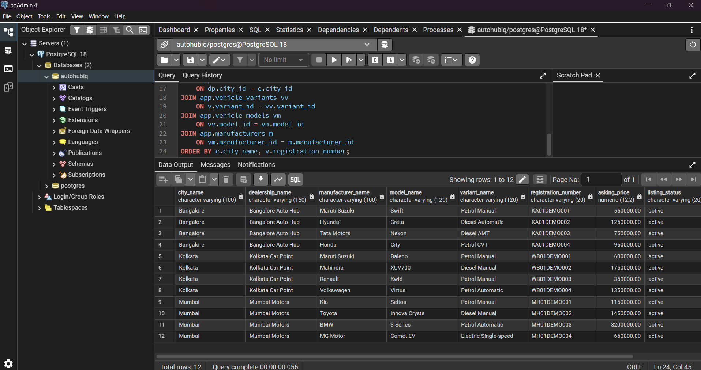
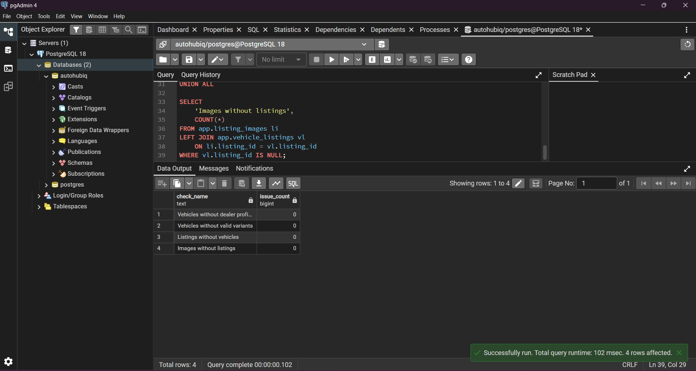

# AutoHubIQ Project Report - Submission Draft

PES University - Department of Computer Science and Engineering  
Database Management System - Experiential Learning Level 3 MiniProject  
Academic session: August-December 2026  
Prepared: 13 November 2026

**Draft status:** Student information, current application/code screenshots,
individual contributions, and final GitHub publication remain pending. This
report describes the local workspace, including changes newer than commit
`39df28e`; it does not claim those changes are already published on GitHub.

## 1. Title

**AutoHubIQ: An Intelligent Used-Car Marketplace and Dealership Analytics Platform**

Repository link for submission: <https://github.com/Ronit77x/AutoHubIQ>

## 2. Students SRN and Name

**Pending:** Insert every team member's full name and SRN. Add rows as needed;
the number of students has not been supplied.

| Student name | SRN | Individual contribution and evidence |
| --- | --- | --- |
| Pending | Pending | Pending student-authored description |

Each member should describe their actual contribution and be ready to explain
or modify their work during the viva. Do not claim contributions or originality
based solely on the existence of generated source code.

## 3. Abstract

AutoHubIQ is a used-car marketplace and dealership analytics application that
combines relational data management with vector similarity search. PostgreSQL
stores users, dealerships, vehicle catalogues, inventory, images, price
estimates, and buyer requests. The pgvector extension stores 384-dimensional
listing embeddings and supports cosine similarity searches for natural-language
vehicle descriptions. A Next.js interface connects shoppers, dealers, and
administrators to parameterized database operations. Dealers require
administrator verification before publishing inventory, and ownership checks
restrict inventory modifications. Views, a search function, timestamp triggers,
CTEs, joins, correlated subqueries, constraints, and transactions demonstrate
DBMS concepts. The local demonstration contains 12 illustrative listings across
three cities. Indicative estimates are separate from asking prices and are not
verified market valuations. Automated tests cover authentication and key
marketplace workflows; final visual evidence remains to be captured.

## 4. Tech Stack

| Layer | Technology | Reason for selection |
| --- | --- | --- |
| Application and API | Next.js 16.4.3 App Router and Route Handlers | Keeps UI and server endpoints in one TypeScript project |
| Interface | React 19.3, TypeScript, Tailwind CSS 4, lucide-react | Component-based pages, typed data, and responsive styling |
| Relational database | PostgreSQL | Transactions, constraints, joins, views, functions, and triggers |
| Vector database capability | pgvector 0.8.7 | Vector data and similarity operators beside relational filters |
| Embeddings | Transformers.js; `onnx-community/all-MiniLM-L6-v2-ONNX` | Local normalized 384-dimensional text embeddings after model download |
| Database access | `pg` connection pool | Parameterized SQL and explicit transaction control |
| Authentication | Node.js scrypt, HMAC-SHA256, HttpOnly session cookie | Salted password hashes and signed sessions with server-side role checks |
| Photo processing | sharp | Decode, resize, strip metadata, and normalize uploaded images to JPEG |
| Development | Node.js, npm, Git/GitHub; Windows workspace | Local development, validation, and source versioning |

pgvector satisfies the rubric's **NoSQL/Vector** option through a vector
extension to PostgreSQL. The project does not implement a separate NoSQL
document database, and it should not be described as doing so.

Architecture, ER diagram, and data dictionary:
[architecture-and-demo.md](architecture-and-demo.md). The relational catalogue
separates manufacturers, models, variants, physical vehicles, and listings.
Primary and foreign keys express identity and ownership; unique and check
constraints enforce email, price, status, and other data rules. Only one active
listing per vehicle is permitted by a partial unique index.

Local setup verification recorded three cities, 12 active demo listings,
12 embeddings, and one demo administrator. These are local observations,
not counts read from the GitHub repository.

## 5. SQL - Database Commands

Full executable definitions are in [database/schema](../database/schema/);
seed DML is in [database/seed](../database/seed/). The following commands are
representative examples. Run modification demonstrations in the temporary test
database or inside a rollback transaction.

```sql
-- DDL: schema creation; table definitions add PK/FK/UNIQUE/CHECK constraints.
CREATE SCHEMA IF NOT EXISTS app;

-- READ and JOIN: fetch listing and physical vehicle information.
SELECT vl.listing_id, vl.asking_price, v.manufacturing_year, v.kms_driven
FROM app.vehicle_listings vl
JOIN app.vehicles v ON v.vehicle_id = vl.vehicle_id
WHERE vl.listing_status = 'active'
ORDER BY vl.asking_price;

-- UPDATE and transaction control: reversible classroom demonstration.
BEGIN;
UPDATE app.vehicle_listings
SET asking_price = asking_price + 1000
WHERE listing_id = (SELECT MIN(listing_id) FROM app.vehicle_listings)
RETURNING listing_id, asking_price;
ROLLBACK;

-- Reusable view and SQL function.
SELECT * FROM app.dealer_inventory_summary;
SELECT * FROM app.search_active_listings(
    p_city_id := 1::SMALLINT,
    p_max_price := 1500000::NUMERIC,
    p_fuel_type := 'Diesel'::TEXT,
    p_transmission := 'Automatic'::TEXT
);
```

| Required concept | Source evidence |
| --- | --- |
| DDL and constraints | `database/schema/02_create_core_tables.sql`, `04_create_dealer_profiles.sql`, `05_create_vehicle_catalogue.sql`, `06_create_inventory_tables.sql` |
| INSERT | Seed scripts; registration and dealer publishing APIs |
| SELECT | City listing, analytics, and inventory query files |
| UPDATE | `database/queries/08_listing_status_transaction.sql`; dealer price/status API |
| DELETE | Vector RUD demonstration in section 6; cascading image/embedding foreign keys are also defined |
| Joins | `database/queries/01_city_based_search.sql` and listing APIs |
| Correlated subqueries | `database/queries/11_above_city_average.sql` |
| CTE and window functions | `database/queries/27_advanced_database_features.sql` and city-ranking queries |
| Views, function, triggers | `database/schema/14_advanced_database_features.sql` |
| Integrity checks | `database/queries/26_database_integrity_checks.sql` |
| Transactions | Seed scripts, registration, publishing, dealer verification, and rollback demos |

The query criterion lists nested/correlated/recursive queries together. This
project demonstrates correlated subqueries and joins; it does not claim a
recursive query implementation. Confirm with the instructor if recursion is
separately mandatory.

## 6. NoSQL/Vector Database Commands

Schema source: [15_create_listing_embeddings.sql](../database/schema/15_create_listing_embeddings.sql).

```sql
CREATE EXTENSION IF NOT EXISTS vector;

CREATE TABLE IF NOT EXISTS app.listing_embeddings (
    listing_id BIGINT PRIMARY KEY
        REFERENCES app.vehicle_listings(listing_id) ON DELETE CASCADE,
    embedding VECTOR(384) NOT NULL,
    source_text TEXT NOT NULL,
    model_name TEXT NOT NULL,
    generated_at TIMESTAMPTZ NOT NULL DEFAULT CURRENT_TIMESTAMP
);

CREATE INDEX IF NOT EXISTS idx_listing_embeddings_cosine
ON app.listing_embeddings USING hnsw (embedding vector_cosine_ops);

SELECT listing_id, vector_dims(embedding) AS dimensions
FROM app.listing_embeddings ORDER BY listing_id;
```

The application embeds the user's description locally and uses
`embedding <=> query_vector` for cosine distance, with similarity expressed
as `1 - distance`. SQL applies city, budget, fuel, and transmission filters
before returning the ranked page. An index is defined, but the report does
not claim PostgreSQL chooses HNSW for every small filtered query.

Creation and refresh:

```powershell
cd frontend
npm.cmd run db:embed
npm.cmd run test:vector
```

The embedding backfill uses `INSERT ... ON CONFLICT ... DO UPDATE` when source
text or model changes. Dealer publishing inserts the vehicle, listing, and
embedding in a transaction after generating the vector.

Executable READ/UPDATE/DELETE evidence:
[28_vector_read_update_delete_demo.sql](../database/queries/28_vector_read_update_delete_demo.sql).
Run the whole file in one connection. It reads nearest neighbours using a
stored reference vector, temporarily replaces one sample vector, deletes that
sample, and rolls back. The replacement is a synthetic DBMS operation demo;
production updates must regenerate the vector from the corresponding text.

**Verified locally:** The demo returned five similarity matches, updated one
vector, deleted one vector, and restored all 12 original embeddings and metadata.
The verification compares complete before/after row fingerprints.

## 7. Next.js - Project Tree Structure

```text
AutoHubIQ/
|-- database/
|   |-- schema/                 # Core, advanced, vector, upload/enquiry DDL
|   |-- seed/                   # Catalogue, dealership, inventory, images, estimates
|   `-- queries/                # SQL analytics, integrity checks, vector RUD
|-- docs/
|   |-- architecture-and-demo.md
|   `-- project-report-draft.md
|-- screenshots/               # Existing database screenshots
`-- frontend/
    |-- app/
    |   |-- page.tsx            # Marketplace, filters, sorting, paging, semantic search
    |   |-- account/page.tsx    # Customer/dealer registration and login
    |   |-- dealer/page.tsx     # Inventory, publishing, photos, buyer requests
    |   |-- admin/page.tsx      # Dealership verification
    |   |-- listings/[listingId]/
    |   `-- api/
    |       |-- auth/{register,login,logout,me}/
    |       |-- cities/
    |       |-- listings/[listingId]/enquiries/
    |       |-- dealer/{catalog,dashboard,listings}/
    |       |-- dealer/listings/[listingId]/images/
    |       |-- admin/dealers/
    |       |-- images/[imageId]/
    |       |-- search/
    |       `-- db-check/       # Admin-only diagnostic
    |-- components/            # Workspace header and enquiry form
    |-- lib/                   # Database, auth, embeddings, rate limits
    |-- public/cars/           # Illustrative seed images
    |-- scripts/               # Setup, embeddings, demo admin, workflow/vector tests
    |-- .env.example           # Template only; real environment is ignored
    `-- package.json
```

The API is implemented inside Next.js; there is no separate backend project.
This is a condensed tree, not a literal listing of every generated file.

## 8. Few Sample Screenshots of Application Code and Demo

Existing screenshots below were inspected and are historical database
evidence. They do not demonstrate the new application workflows.



*Figure 1. Existing pgAdmin output showing the twelve illustrative vehicle listings.*



*Figure 2. Existing pgAdmin checks showing zero issues for four foreign-key relationships.*

**Pending screenshots to capture from the current app/code:**

| Evidence | What the screenshot should show |
| --- | --- |
| Marketplace | City selected, vehicle cards, filters and sorting |
| Semantic search | Natural-language query, applied city/budget, ranked results |
| Listing detail | Asking price, distinct indicative estimate, specifications, photos |
| Authentication | Registration/login UI without passwords or session values |
| Admin | Pending dealer and verification action/result |
| Dealer | Published vehicle, inventory totals, price/status controls, uploaded photo |
| Buyer request | Customer request and corresponding dealer inbox entry |
| Vector code and output | `vector(384)`, cosine query, RUD outputs and rollback restoration |
| Application code | Parameterized query and server-side role/ownership checks |
| Validation | Successful build and workflow/vector test summaries |

Capture genuine application states. Do not substitute mockups for execution
evidence. Exclude `.env.local`, `.demo-credentials.txt`, passwords, session
cookies, and database connection strings from screenshots.

## 9. Evaluation Rubrics - Completion Status

This is a self-assessment of implementation and evidence, **not an awarded
mark or a guarantee of full marks**. Maxima below follow the supplied rubric.

| Evaluation component | Max marks | Completion status and evidence |
| --- | ---: | --- |
| ER diagram | 2 | Documented in architecture guide; render and include in final exported report |
| Relational schema, keys, relationships, constraints | 3 | Implemented in schema scripts; data dictionary and relationships documented |
| SQL database implementation / DDL with constraints | 4 | Implemented; clean-database schema setup exercised by workflow test |
| NoSQL/Vector database creation | 4 | pgvector extension, vector table and HNSW index implemented; 12 vectors generated |
| Technology justification | 1 | Included in section 4 |
| DML operations | 4 | INSERT/SELECT/UPDATE in seed/API workflows; DELETE demonstrated transactionally in vector demo |
| Nested/correlated/recursive queries and joins | 4 | Correlated subquery and joins present; no recursive-query claim |
| Advanced SQL: procedure/function, trigger, CTE | 6 | SQL search function, timestamp trigger function/triggers, CTEs and views present |
| NoSQL/Vector feature, RUD | 7 | Semantic ranking and filters implemented; explicit vector RUD test passes with rollback |
| Next.js interface | 3 | Implemented; production build passes; fresh UI screenshots and visual verification pending |
| Backend/API and database integration | 2 | Implemented; isolated workflow test passed 62 HTTP checks plus assertions |
| Authentication and authorization, at least two roles | 4 | Customer/dealer/admin; password/session tests and protected API/ownership checks pass; roles stored in DB and enforced by API, no separate PostgreSQL GRANT-role implementation claimed |
| Documentation, Git/GitHub | 2 | Setup, architecture and report draft present; final report and latest changes still need publication |
| Originality, contribution, modification/viva | 4 | Pending student-authored contributions and individual demonstration; cannot be certified by automated tests |
| **Total available** | **50** | **Final assessment belongs to the evaluator** |

The supplied rubric's authentication row lists a maximum of 4 but 3 in its
"Correct Execution" column. This draft uses the stated maximum of 4 and does
not resolve or award marks for that inconsistency.

Validation completed in this workspace on 13 November 2026:

- TypeScript check, lint, two authentication tests, and production build passed.
- Isolated workflow regression passed 62 HTTP checks plus assertions for
  registration, role boundaries, verification, publishing, photos, enquiries,
  ownership, filters/paging, semantic search, listing status, and throttling.
- Vector RUD regression passed; original database vectors were restored.
- Browser visual verification was unavailable because the browser host could
  not be reached. Do not describe this as a completed visual/UI test.

Before submission: fill student details, render/include the ERD, capture the
pending screenshots, record each member's actual contributions, export the
final report, and commit/push the reviewed local changes. No commit or push
has been performed as part of preparing this draft.
