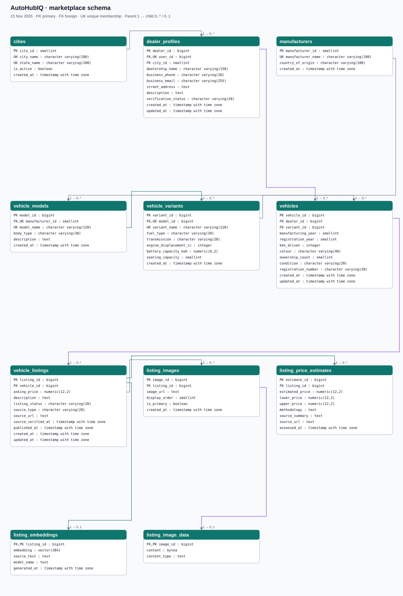
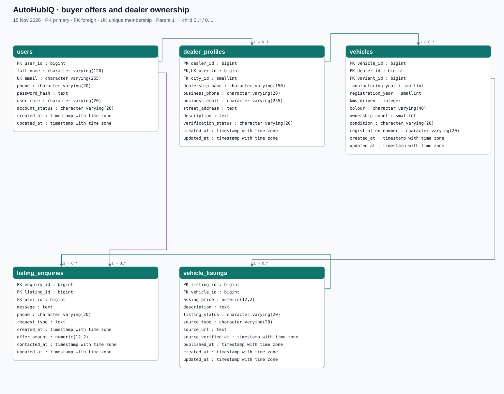
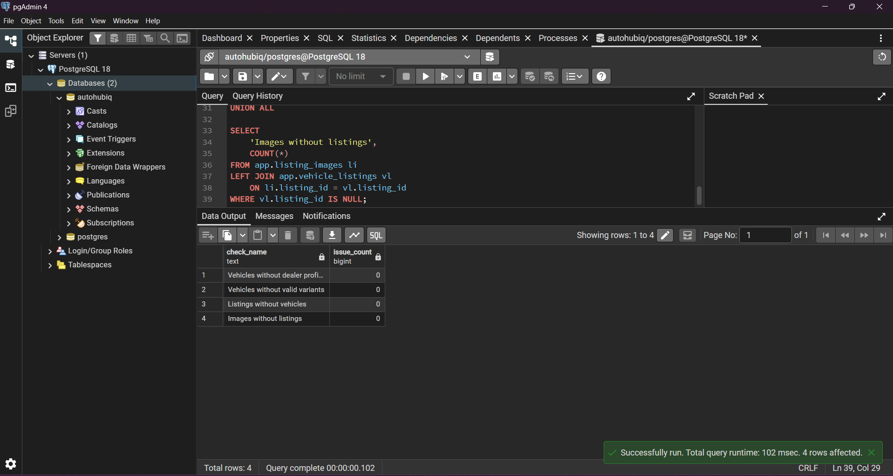
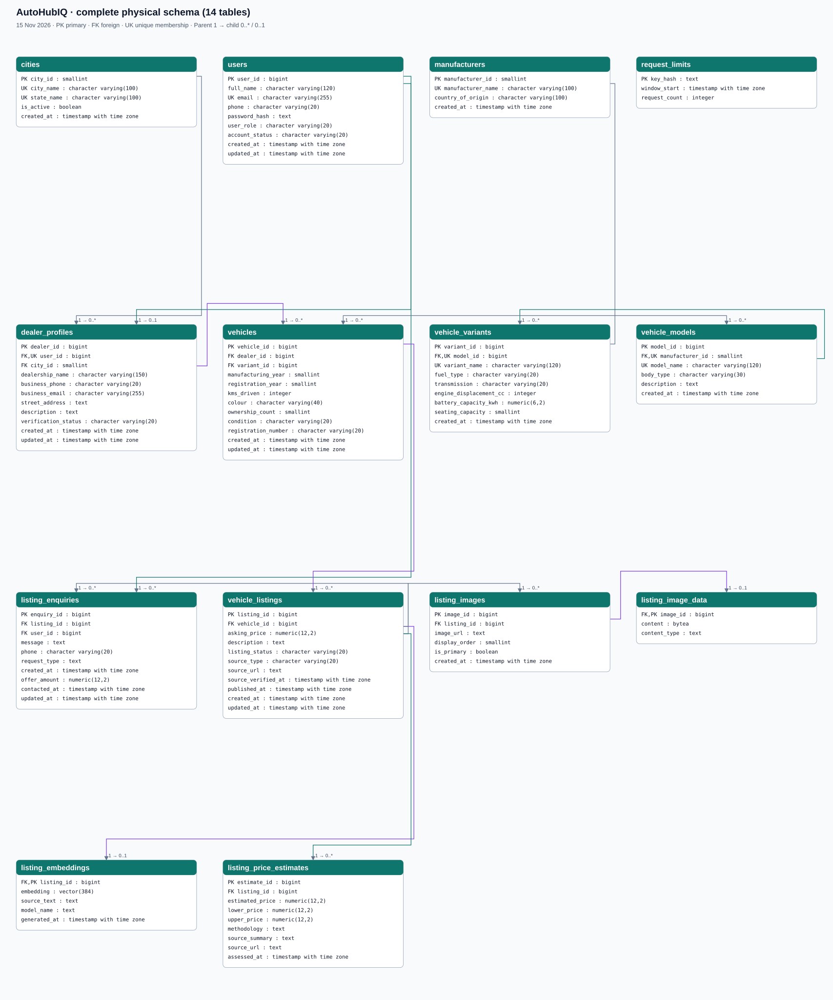

# AutoHubIQ Project Report

An Intelligent Used Car Marketplace and Dealership Analytics Platform

PES University
Department of Computer Science and Engineering
Database Management System
Experiential Learning Level 3 MiniProject
Semester 5 | Section I | August-December 2026

Ronit Prasad | PES1UG24CS549
Sanjana Medarametla | PES1UG24CS908

Repository https://github.com/Ronit77x/AutoHubIQ
Report prepared 15 November 2026

## Abstract

AutoHubIQ combines a used-car marketplace with dealership inventory analytics using Next.js, TypeScript, PostgreSQL and pgvector. A fourteen-table relational schema separates users, dealers, the vehicle catalogue, physical inventory, listings, images, indicative estimates and buyer interactions. Normalized 384-dimensional MiniLM embeddings support natural-language retrieval alongside structured SQL filters. Customer, dealer and administrator roles provide enquiries, test-drive requests, offers, pre-contact offer revision, verified inventory publishing and dealership approval. Database features include constraints, joins, nested/correlated queries, views, functions, triggers, CTEs, indexes and transactions. The audited dataset contains twelve active illustrative listings across three cities. Verification includes ninety-three workflow HTTP checks, twenty-two public GET checks, schema reconciliation and vector read/update/delete restoration. The system provides inventory indicators rather than confirmed-sales analytics; indicative estimates and demo images are explicitly illustrative.

## Introduction

AutoHubIQ is an intelligent used-car marketplace and dealership inventory analytics platform developed for the Database Management System Experiential Learning Level 3 mini project at PES University. It integrates a Next.js web application with PostgreSQL and pgvector so that structured vehicle data and semantic search can be queried within the same database system.

Used-car descriptions vary in wording, detail and quality. Customers need to compare specifications, asking prices and locations while describing preferences in natural language. Dealers need consistent inventory ownership, publication controls and a way to receive buyer requests. The project addresses these needs with a relational catalogue, listing-level data, indicative price estimates, role-aware workflows and vector similarity retrieval.

### Objectives
- Design a relational schema with primary keys, foreign keys, unique constraints, CHECK constraints and useful indexes.
- Integrate vehicle browsing, detailed listings, images and indicative estimates with a Next.js interface.
- Support natural-language discovery using normalized 384-dimensional embeddings and cosine similarity.
- Implement customer, dealer and administrator accounts with server-side authorization and ownership checks.
- Demonstrate joins, multiple nested/correlated queries, grouping, CTEs, functions, triggers, views, transactions and vector read/update/delete operations.
- Provide reproducible test evidence and clear documentation of the implemented scope.

### Scope
The marketplace supports Bangalore (Bengaluru), Mumbai and Kolkata. The audited demonstration has twelve active illustrative listings, four in each city, twelve indicative estimates and twelve listing embeddings. Six seeded dealerships own two demo vehicles each; an additional registered Bangalore dealer profile exists in the local database.

The delivered application includes inventory analytics, dealer verification, buyer enquiries, test-drive requests, offers and pre-contact offer editing. Confirmed sales, payment processing, timed auctions, actual sale revenue and general account administration are outside the implemented scope.

## Requirements and technology

The system separates public browsing from authenticated customer, dealer and administrator operations. The following requirements describe delivered behavior.

| User | Functional requirements |
| --- | --- |
| Shopper | Choose a city; browse, filter, sort and page active listings; inspect specifications, images and indicative estimates; use semantic search. |
| Customer | Register and sign in; submit enquiries, test-drive requests and price offers; view and edit owned offers while eligible. |
| Dealer | Register a dealership; await administrator verification; publish with required details and optional photos; update price/status; review buyer requests; mark an offer contacted. |
| Administrator | Review dealership applications; verify or reject a dealership; access protected diagnostics. |

| Technology | Purpose and justification |
| --- | --- |
| Next.js 16.4.3 and React 19.3 | App Router pages and Route Handlers provide one integrated web application and API. |
| TypeScript and Tailwind CSS | Typed application code and consistent responsive interface styling. |
| PostgreSQL 18.6 | Relational storage, constraints, joins, aggregates, transactions, views, functions and triggers. |
| pgvector 0.8.7 | Vector storage and cosine-distance retrieval beside relational data; satisfies the SQL plus Vector approach. |
| Transformers.js and MiniLM ONNX | Local feature extraction with mean pooling and normalized 384-dimensional vectors after model download. |
| Node.js pg and sharp | Parameterized database access and normalized JPEG photo storage. |
| Git and GitHub | Version history and project source distribution. |

pgvector is an extension within PostgreSQL, not a separate database server or a separate document database. The embedding model used in code is onnx-community/all-MiniLM-L6-v2-ONNX. [2, 3]

## System architecture

The browser communicates with Next.js pages and API routes. Route Handlers validate requests, authenticate protected operations and issue parameterized SQL through a PostgreSQL connection pool. PostgreSQL stores business records, image bytes, price estimates, request budgets and listing vectors in the app schema.

Browser -> Next.js pages and Route Handlers -> PostgreSQL app schema (including pgvector); local MiniLM generates query and listing embeddings.

Public listing endpoints read active inventory. Semantic search generates a local embedding for the customer query, combines similarity ranking with structured SQL filters and returns a page of results. The vector table is part of the same PostgreSQL database shown in the architecture.

For publishing, the server checks dealer verification and validates vehicle/listing details. It generates an embedding, then inserts the physical vehicle, active listing and embedding in a single transaction. Photo uploads occur separately and are optional; uploaded content is decoded, normalized to JPEG and stored in PostgreSQL.

Protected requests verify a signed HttpOnly session cookie, then re-read the current account role and active status from the database. The browser interface is not the authorization boundary. API ownership predicates restrict dealer inventory changes and buyer offer changes.

## Database design and entity relationships

The physical design contains fourteen base tables. Manufacturers, models and variants form the reusable vehicle catalogue. Vehicles represent physical inventory; listings hold asking prices, descriptions, publication state and provenance. Keeping vehicles separate from listings permits historical listing records while a partial unique index allows at most one active listing per vehicle.



Each model belongs to one manufacturer and each variant to one model. A vehicle belongs to one dealer and one catalogue variant. A dealership belongs to one city and one user account; the user_id constraint permits at most one dealer profile per account. A city may contain multiple dealerships.

Listing images, price estimates, embeddings and buyer interactions reference listings. A listing may have multiple dated estimates; the current display selects the latest. Its embedding uses listing_id as both primary key and foreign key, so there is at most one vector per listing. Uploaded JPEG data similarly uses image_id as its primary/foreign key.

The design reduces repetition of catalogue attributes and separates records with different lifecycles. This is a normalization rationale based on the implemented entities and keys; it is not a formal proof of every functional dependency.

## Buyer offers and supporting relations

Enquiries, test drives and offers share listing_enquiries. request_type distinguishes the interaction; offer_amount is present only for offers. There is no separate bids or auction table. contacted_at records the dealer-entered contact status, while updated_at records an offer edit.



A customer submits an offer from a listing and views it under My offers. The customer can revise the owned amount, message and phone while the listing is active, the dealership is verified and contacted_at is NULL. The dealer sees revised data in the existing inbox. After contacting the buyer, the owning dealer selects Mark contacted, which closes editing. External calls and emails are not detected automatically.

Transactions and row locks serialize edits against contact marking and relevant listing/profile changes. Contacted or unavailable offers remain visible in history. No offer reserves or purchases a vehicle.

request_limits is an independent operational table with a hashed key, time window and request count. It has no business-entity foreign key. listing_image_data contains uploaded image bytes; demo/reference image URLs remain in listing_images. The complete typed dictionary in Appendix B includes all fourteen tables and their constraints.

## Relational integrity and indexing

Primary keys identify records. Foreign keys connect catalogue, ownership, inventory and listing-related data. Unique constraints prevent duplicate user emails, duplicate manufacturer names, duplicate model names within a manufacturer and duplicate variant names within a model. A separate LOWER(email) unique index supports case-insensitive email uniqueness.

| Database mechanism | Implemented rule |
| --- | --- |
| Partial unique index | vehicle_listings(vehicle_id) is unique where listing_status is active. |
| CHECK constraints | Positive prices; allowed role/status/source values; nonnegative mileage; owner count 1-10; catalogue fuel/transmission/body values; valid estimate bounds. |
| Conditional offer CHECK | Offer rows require positive offer_amount; non-offer rows require NULL offer_amount. |
| Payload CHECK | Stored image content is no larger than 2 MB and has the normalized JPEG content type. |
| Cascade deletion | Deleting a listing cascades to images, estimates, embeddings and interactions; deleting an image cascades to its stored payload. Other FKs use NO ACTION. |
| B-tree indexes | Support city, dealer, variant, year, mileage, listing price/status, enquiry and estimate lookups. |
| HNSW index | Uses vector_cosine_ops on listing embeddings for cosine-distance search capability. |

API rules are intentionally distinguished from database constraints. SQL year checks permit 1990-2030, whereas the create-listing API also rejects future years and registration before manufacture. Description length, dealer verification, photo-count limits and offer-edit eligibility are checked in the API. The schema does not independently enforce customer/dealer roles across foreign keys.

Registration numbers have no unique constraint, and primary-image selection has no unique partial index. Estimate bounds must be positive and ordered, but the central estimate is not forced inside that range by a CHECK. These are implementation limits rather than guarantees claimed by this report.

## SQL operations and query examples

The application performs meaningful INSERT, SELECT and UPDATE operations. Customer/dealer registration inserts accounts and profiles; publishing inserts inventory, listing and vector rows; listing maintenance and offer revision update existing rows. Public APIs and SQL analytics read related data through joins. Vector DELETE is demonstrated within a rollback transaction so that the sample is restored.

### Joined listing retrieval

The following representative query connects listings, physical vehicles and dealerships. Actual routes add catalogue data, estimates, images, filters, sorting and pagination.

```sql
SELECT vl.listing_id, dp.dealership_name,
       v.manufacturing_year, vl.asking_price
FROM app.vehicle_listings vl
JOIN app.vehicles v USING (vehicle_id)
JOIN app.dealer_profiles dp USING (dealer_id)
WHERE vl.listing_status = 'active'
ORDER BY vl.asking_price;
```

### Nested query for prices above the overall average

Query 10 compares each active asking price with a nested aggregate over active listings. The full stored query joins the vehicle catalogue and city for readable results. [4]

```sql
SELECT listing_id, asking_price
FROM app.vehicle_listings
WHERE listing_status = 'active'
  AND asking_price > (
    SELECT AVG(asking_price)
    FROM app.vehicle_listings
    WHERE listing_status = 'active'
  );
```

### Correlated query for prices above the city average

Query 11 correlates the inner dealer city to the outer dealer city. Unlike the overall-average example, its comparison group changes for each outer city.

```sql
SELECT vl.listing_id, dp.city_id, vl.asking_price
FROM app.vehicle_listings vl
JOIN app.vehicles v USING (vehicle_id)
JOIN app.dealer_profiles dp USING (dealer_id)
WHERE vl.listing_status = 'active'
  AND vl.asking_price > (
    SELECT AVG(vl2.asking_price)
    FROM app.vehicle_listings vl2
    JOIN app.vehicles v2 USING (vehicle_id)
    JOIN app.dealer_profiles dp2 USING (dealer_id)
    WHERE dp2.city_id = dp.city_id
      AND vl2.listing_status = 'active'
  );
```

### Nested aggregation for dealer activity

Query 15 groups inventory by dealer, then applies HAVING against a nested average of dealer listing counts. This provides a third distinct nested/correlated-query example. A valid empty result is possible when the dealers have equal active counts; it is not evidence of query failure.

```sql
SELECT dp.dealer_id, COUNT(vl.listing_id) AS total
FROM app.dealer_profiles dp
LEFT JOIN app.vehicles v USING (dealer_id)
LEFT JOIN app.vehicle_listings vl
  ON vl.vehicle_id = v.vehicle_id
 AND vl.listing_status = 'active'
GROUP BY dp.dealer_id
HAVING COUNT(vl.listing_id) > (
  SELECT AVG(listing_count)
  FROM (
    SELECT COUNT(vl2.listing_id) AS listing_count
    FROM app.dealer_profiles dp2
    LEFT JOIN app.vehicles v2 USING (dealer_id)
    LEFT JOIN app.vehicle_listings vl2
      ON vl2.vehicle_id = v2.vehicle_id
     AND vl2.listing_status = 'active'
    GROUP BY dp2.dealer_id
  ) AS dealer_counts
);
```

Additional nested lookups select the latest price estimate using a LATERAL subquery ordered by assessment time. Queries 12, 17, 24 and 27 demonstrate grouping, ranking and common table expressions. Recursive queries are not claimed; the project demonstrates multiple nested/correlated queries under the combined rubric category.

## Advanced database concepts

### Views and reusable functions
app.active_listing_details joins inventory, catalogue, dealer/city and the latest price estimate for active listings. app.dealer_inventory_summary exposes active listing count, total asking value and average asking price. These are inventory indicators, not confirmed sales revenue.

app.search_active_listings is a STABLE SQL function that accepts optional city, maximum price, fuel and transmission filters. A separate PL/pgSQL trigger function, app.set_updated_at, updates modification timestamps.

```sql
SELECT * FROM app.search_active_listings(
  p_city_id := 1::SMALLINT,
  p_max_price := 1500000::NUMERIC,
  p_fuel_type := 'Diesel'::TEXT,
  p_transmission := 'Automatic'::TEXT
);
```

### Triggers
Three BEFORE UPDATE triggers call set_updated_at on dealer_profiles, vehicles and vehicle_listings. The audit attempted to assign an old timestamp in a disposable database and verified that each trigger replaced it with a current timestamp, then rolled back the test. listing_enquiries.updated_at is assigned by the offer API; no generic enquiry or users timestamp trigger is claimed.

### Common table expressions and ranking
Query 27 first aggregates active listings and prices by city, then applies DENSE_RANK to the summary. This separates aggregation from ranking and avoids repeating the same aggregate query.

```sql
WITH city_stats AS (
  SELECT c.city_name, COUNT(vl.listing_id) AS total
  FROM app.cities c
  LEFT JOIN app.dealer_profiles dp USING (city_id)
  LEFT JOIN app.vehicles v USING (dealer_id)
  LEFT JOIN app.vehicle_listings vl
    ON vl.vehicle_id = v.vehicle_id
   AND vl.listing_status = 'active'
  GROUP BY c.city_id
)
SELECT *, DENSE_RANK() OVER (ORDER BY total DESC)
FROM city_stats;
```

### Transactions and concurrency
Registration, dealer approval/rejection and inventory publishing use explicit transactions. A publishing error rolls back the vehicle/listing/vector inserts together. Rejection withdraws the dealer's active listings transactionally. Offer editing and dealer contact marking lock the relevant rows to enforce the editing boundary. The vector operation demonstration uses ROLLBACK to restore every modified vector and metadata value.

## Vector storage and semantic retrieval

The application uses the SQL plus Vector database option in the rubric. A dedicated listing_embeddings table stores one vector per listing. The primary key is also a foreign key to vehicle_listings, and deletion of the parent cascades to the vector row.

```sql
CREATE EXTENSION IF NOT EXISTS vector;
CREATE TABLE app.listing_embeddings (
  listing_id BIGINT PRIMARY KEY
    REFERENCES app.vehicle_listings(listing_id)
    ON DELETE CASCADE,
  embedding VECTOR(384) NOT NULL,
  source_text TEXT NOT NULL,
  model_name TEXT NOT NULL,
  generated_at TIMESTAMPTZ NOT NULL
    DEFAULT CURRENT_TIMESTAMP
);
CREATE INDEX idx_listing_embeddings_cosine
ON app.listing_embeddings
USING hnsw (embedding vector_cosine_ops);
```

The source text includes make, model, variant, year, body/fuel/transmission, condition, ownership count, mileage, city, colour when present, and listing description. Transformers.js runs the MiniLM ONNX model locally after downloading its model files. Mean pooling and normalization produce 384 finite values; the application rejects invalid dimensions or nonfinite results.

At query time the server embeds the natural-language request, applies structured filters in SQL and orders by the cosine-distance operator <=>. A displayed similarity is computed as 1 minus cosine distance. Supported intent extraction can narrow budget, body type, fuel and transmission group; explicit city selection and request filters remain part of retrieval. Pagination follows relevance order.

For the twelve-row demonstration, an HNSW index exists but the report does not claim a measured speed advantage or a particular query plan. The planner may choose a scan at this scale. Asking price changes do not require vector regeneration because price is handled by SQL filters rather than embedded source text.

Query 28 demonstrates read/update/delete using stored sample vectors. The audit returned five nearest matches, temporarily replaced one sample vector, deleted that sample and rolled back. A before/after fingerprint verified restoration. The replacement is a synthetic operation demonstration; a production text change should regenerate the corresponding vector rather than copy another vehicle's embedding.

## Application workflows and authorization

Registration accepts customer and dealer accounts; public registration cannot create an administrator. A dealer supplies dealership and city information and starts pending. An administrator uses the verification dashboard to approve or reject the dealership. Verified dealers may publish immediately without photos when required vehicle details and a 20-5000 character description are present.

The dealer workspace displays inventory totals, asking-price/status controls, uploads and the latest buyer requests. Existing listing edits cover price and status; full vehicle specification and description editing is not implemented. Customers use the listing contact form for enquiries, test-drive requests and price offers, then My offers for eligible revisions.

| API group | Role and ownership boundary |
| --- | --- |
| /api/cities, /api/listings, /api/search | Public reads/search with validation and applicable request budgets. |
| /api/auth/* | Registration, password verification, signed session, account lookup and logout. |
| /api/dealer/* | Dealer role; listing and image changes restricted to owned inventory; publishing/activation require verification. |
| /api/admin/dealers | Administrator role; dealership review and decisions. |
| GET /api/offers | Customer role; returns only the signed-in buyer's offers. |
| PATCH /api/offers/:id | Owning customer edits before contact; owning dealer may mark contacted. |

Passwords use salted scrypt hashes. Session payloads are signed using HMAC-SHA256 and placed in HttpOnly, SameSite=Lax cookies, with Secure enabled in production and a seven-day expiry. The server re-reads active account status and role on protected requests. Logout clears the browser cookie; this is not a server-side session revocation list.

Parameterized SQL, same-origin mutation checks, validation and database-backed request budgets protect the demonstrated workflows. Password visibility is optional and defaults to hidden. Demo login credentials and database configuration remain outside report screenshots and version control.

End-user roles are stored in PostgreSQL and enforced by API queries. The project does not implement PostgreSQL login roles per customer, GRANT-based end-user separation or row-level-security policies. This accurately describes database-backed application authorization under the team's interpretation of the rubric; no database-native role policy is claimed.

## Testing and results

The implementation was audited on 15 November 2026. The configured database was inspected through read-only queries. Schema/seed application, advanced SQL behavior, trigger tests and vector RUD were exercised in disposable databases. Application build and regression checks used an isolated copy of the committed source. [5]

| Verification | Observed result |
| --- | --- |
| Authentication unit tests | Two tests passed for password hashing and signed-session validation. |
| ESLint | Passed without rewriting application files. |
| Production build and TypeScript | Passed in an isolated copy. A network-enabled retry supplied existing Google Fonts dependencies after a restricted-network attempt failed. |
| Workflow regression | 93 HTTP checks plus assertions passed in a temporary database. |
| All-city public API audit | 22 GET checks passed across three cities, including filters, sorted results, empty results and all twelve detail records with images/estimates. |
| Schema reconciliation | All fourteen tables, columns, constraints, indexes, views, functions and triggers matched a clean install. |
| Data coverage | Twelve active listings, twelve estimates and twelve embeddings; no active listing lacked an estimate or vector. |
| Integrity query 26 | Zero issues for its four orphan checks. |
| Trigger and advanced SQL | Three timestamp triggers verified; view/function, CTE and correlated-query execution passed. |
| Vector RUD | Five matches, one update, one delete and complete rollback restoration in a disposable database. |

The workflow regression exercises role restrictions, unauthorized requests, dealer approval, publishing without photos, image validation/limits, enquiries, offer creation and revision, dealer contact marking, inventory ownership, listing status, filters/paging, semantic search and throttling. A buyer cannot edit another buyer's offer, mark their own offer contacted as a dealer, or revise a contacted/unavailable offer.

The automated write/search workflow concentrates on one selected city. The additional GET audit covers browsing and details for all cities. Tests do not establish exhaustive API branch coverage, browser responsiveness, external email/call delivery, large-scale query performance or concurrency behavior under sustained load. Those are not claimed results.



Figure 4 shows historical pgAdmin output for the four orphan checks. The same checks were re-executed during the dated audit and returned zero issues. This is database evidence, not a screenshot of the current web interface. The current source contains the marketplace, account, dealer, admin, listing and offer pages; automated HTTP checks should not be mistaken for a visual browser test.

## Team contributions

The project was developed jointly. Both members participated in requirements, design discussions, implementation, integration, debugging and review. The following equal division records primary responsibility for organizing and presenting the shared work; it does not imply exclusive or independent authorship of the listed features.

| Member | SRN | Primary responsibility within the joint project |
| --- | --- | --- |
| Ronit Prasad | PES1UG24CS549 | Relational design and constraints; SQL queries and inventory analytics; dealer/admin workflows; authentication and role/ownership explanations. |
| Sanjana Medarametla | PES1UG24CS908 | Marketplace and listing interfaces; semantic/vector search; customer enquiries and offers; image handling and workflow-test explanations. |

Both members share responsibility for application/database integration, testing and fixes, documentation review, project decisions and final demonstration. Each member should be able to explain the overall architecture and the boundaries between database constraints and API authorization.

Git history records project changes but is not treated as a precise measure of individual effort. No unsupported percentages, separate implementation claims or fictitious commit ownership are assigned. The repository for review is https://github.com/Ronit77x/AutoHubIQ.

## Evaluation rubric alignment

The attached PES University rubric allocates fifty marks across seven criteria. The table maps the delivered project to those criteria; it does not award marks or imply evaluator approval. [1]

| Criterion | Maximum | Project evidence |
| --- | ---: | --- |
| Database design | 5 | ER relationships, fourteen-table relational schema, typed dictionary and explicit integrity rules. |
| Database creation | 9 | PostgreSQL DDL/constraints; pgvector table/index; SQL plus Vector technology justification. |
| SQL operations and queries | 8 | Application DML; vector DELETE demonstration; several nested/correlated queries; joins, aggregates, HAVING and ordering. |
| Advanced database concepts | 13 | Functions, triggers, CTEs, views, transactions and indexes; vector retrieval and read/update/delete evidence. |
| Web application and database integration | 5 | Next.js interface, Route Handlers, parameterized PostgreSQL access and isolated workflow verification. |
| Authentication and authorization | 4 | Frontend authentication, password hashing and three database-stored roles enforced by protected APIs and ownership checks. |
| Documentation and individual contribution | 6 | Formal report, source repository, query/test evidence, truthful joint contribution statement and student demonstration. |
| Total available | 50 | Final assessment belongs to the evaluator. |

The project uses multiple nested/correlated queries rather than adding a recursive query without a domain need. Role-based access is database-backed API enforcement rather than PostgreSQL end-user RLS. The team considers the vector DELETE demonstration sufficient for the DELETE requirement. These are stated implementation choices and team interpretations, not instructor confirmations.

The source rubric has an internal inconsistency: authentication is allocated four marks in its maximum/distribution but three in the detailed Correct Execution cell. This report retains the stated four-mark maximum without resolving the grading discrepancy.

## Conclusion and future work

AutoHubIQ demonstrates an integrated relational and vector database application rather than an isolated collection of CRUD pages. Structured vehicle catalogue and inventory data support city-based browsing, detailed listing information and indicative price comparisons. Semantic retrieval combines MiniLM embeddings and cosine distance with relational filters. Three account roles support customer interactions, verified dealer inventory and administrator dealership review.

The database demonstrates primary/foreign keys, unique and CHECK constraints, partial and vector indexes, views, functions, triggers, CTEs and transactions. Reproducible checks confirm clean schema installation, the observed twelve-listing dataset, role/ownership workflows and vector read/update/delete restoration. The buyer offer lifecycle adds a concrete use for transactions and ownership checks.

Future enhancements may include a confirmed-sale ledger and actual revenue analytics, broader operator account administration, email/password recovery, stronger database-native policies if needed, production hosting/backups and broader browser/concurrency testing. These are proposed enhancements, not delivered capabilities. Indicative estimates and illustrative vehicle images should not be represented as verified market valuations or vehicle-condition evidence.

The project is presented for Semester 5, Section I, Database Management System Experiential Learning Level 3, August-December 2026. Both authors retain shared responsibility for reviewing the report, validating the contribution statement and explaining the implementation during evaluation.

## Appendix A Complete physical schema

This overview includes all fourteen audited base tables. Each arrow runs from a referenced parent to its child. PK and FK identify key membership. Every child FK is NOT NULL; parent records may have zero children. Dealer user_id, embedding listing_id and image payload image_id are unique on the child, giving a maximum of one corresponding child. Other relationships permit multiple children. The independent request_limits table has no foreign key.



## Appendix B Data dictionary

The following dictionary reflects the audited physical schema. Nullable columns are marked Yes. IDENTITY means GENERATED ALWAYS AS IDENTITY. Full constraint and index definitions are retained in docs/relational-schema.md and docs/evidence/schema-catalog.json. Composite uniqueness applies to the listed column combination, not to each member independently.

### cities

| Column | Type | Null | Key or default |
| --- | --- | --- | --- |
| city_id | smallint | No | PK; IDENTITY |
| city_name | varchar(100) | No | UK member |
| state_name | varchar(100) | No | UK member |
| is_active | boolean | No | true |
| created_at | timestamptz | No | CURRENT_TIMESTAMP |

- UNIQUE (city_name, state_name)

### dealer_profiles

| Column | Type | Null | Key or default |
| --- | --- | --- | --- |
| dealer_id | bigint | No | PK; IDENTITY |
| user_id | bigint | No | FK; UK member |
| city_id | smallint | No | FK |
| dealership_name | varchar(150) | No | - |
| business_phone | varchar(20) | Yes | - |
| business_email | varchar(255) | Yes | - |
| street_address | text | No | - |
| description | text | Yes | - |
| verification_status | varchar(20) | No | 'pending'::character varying |
| created_at | timestamptz | No | CURRENT_TIMESTAMP |
| updated_at | timestamptz | No | CURRENT_TIMESTAMP |

- CHECK (verification_status::text = ANY (ARRAY['pending'::character varying, 'verified'::character varying, 'rejected'::character varying]::text[]))
- FOREIGN KEY (city_id) REFERENCES app.cities(city_id)
- FOREIGN KEY (user_id) REFERENCES app.users(user_id)
- UNIQUE (user_id)

### listing_embeddings

| Column | Type | Null | Key or default |
| --- | --- | --- | --- |
| listing_id | bigint | No | FK; PK |
| embedding | vector(384) | No | - |
| source_text | text | No | - |
| model_name | text | No | - |
| generated_at | timestamptz | No | CURRENT_TIMESTAMP |

- FOREIGN KEY (listing_id) REFERENCES app.vehicle_listings(listing_id) ON DELETE CASCADE

### listing_enquiries

| Column | Type | Null | Key or default |
| --- | --- | --- | --- |
| enquiry_id | bigint | No | PK; IDENTITY |
| listing_id | bigint | No | FK |
| user_id | bigint | No | FK |
| message | text | No | - |
| phone | varchar(20) | Yes | - |
| request_type | text | No | - |
| created_at | timestamptz | No | CURRENT_TIMESTAMP |
| offer_amount | numeric(12,2) | Yes | - |
| contacted_at | timestamptz | Yes | - |
| updated_at | timestamptz | Yes | - |

- FOREIGN KEY (listing_id) REFERENCES app.vehicle_listings(listing_id) ON DELETE CASCADE
- CHECK (length(message) >= 10 AND length(message) <= 2000)
- CHECK (request_type = 'offer'::text AND offer_amount IS NOT NULL AND offer_amount > 0::numeric OR request_type <> 'offer'::text AND offer_amount IS NULL)
- CHECK (request_type = ANY (ARRAY['enquiry'::text, 'test_drive'::text, 'offer'::text]))
- FOREIGN KEY (user_id) REFERENCES app.users(user_id)

### listing_image_data

| Column | Type | Null | Key or default |
| --- | --- | --- | --- |
| image_id | bigint | No | FK; PK |
| content | bytea | No | - |
| content_type | text | No | 'image/jpeg'::text |

- CHECK (octet_length(content) <= 2097152)
- CHECK (content_type = 'image/jpeg'::text)
- FOREIGN KEY (image_id) REFERENCES app.listing_images(image_id) ON DELETE CASCADE

### listing_images

| Column | Type | Null | Key or default |
| --- | --- | --- | --- |
| image_id | bigint | No | PK; IDENTITY |
| listing_id | bigint | No | FK |
| image_url | text | No | - |
| display_order | smallint | No | 1 |
| is_primary | boolean | No | false |
| created_at | timestamptz | No | CURRENT_TIMESTAMP |

- CHECK (display_order > 0)
- FOREIGN KEY (listing_id) REFERENCES app.vehicle_listings(listing_id) ON DELETE CASCADE

### listing_price_estimates

| Column | Type | Null | Key or default |
| --- | --- | --- | --- |
| estimate_id | bigint | No | PK; IDENTITY |
| listing_id | bigint | No | FK |
| estimated_price | numeric(12,2) | No | - |
| lower_price | numeric(12,2) | Yes | - |
| upper_price | numeric(12,2) | Yes | - |
| methodology | text | No | - |
| source_summary | text | Yes | - |
| source_url | text | Yes | - |
| assessed_at | timestamptz | No | CURRENT_TIMESTAMP |

- CHECK (estimated_price > 0::numeric)
- CHECK ((lower_price IS NULL OR lower_price > 0::numeric) AND (upper_price IS NULL OR upper_price > 0::numeric) AND (lower_price IS NULL OR upper_price IS NULL OR lower_price <= upper_price))
- FOREIGN KEY (listing_id) REFERENCES app.vehicle_listings(listing_id) ON DELETE CASCADE

### manufacturers

| Column | Type | Null | Key or default |
| --- | --- | --- | --- |
| manufacturer_id | smallint | No | PK; IDENTITY |
| manufacturer_name | varchar(100) | No | UK member |
| country_of_origin | varchar(100) | Yes | - |
| created_at | timestamptz | No | CURRENT_TIMESTAMP |

- UNIQUE (manufacturer_name)

### request_limits

| Column | Type | Null | Key or default |
| --- | --- | --- | --- |
| key_hash | text | No | PK |
| window_start | timestamptz | No | - |
| request_count | integer | No | - |


### users

| Column | Type | Null | Key or default |
| --- | --- | --- | --- |
| user_id | bigint | No | PK; IDENTITY |
| full_name | varchar(120) | No | - |
| email | varchar(255) | No | UK member |
| phone | varchar(20) | Yes | - |
| password_hash | text | No | - |
| user_role | varchar(20) | No | 'customer'::character varying |
| account_status | varchar(20) | No | 'active'::character varying |
| created_at | timestamptz | No | CURRENT_TIMESTAMP |
| updated_at | timestamptz | No | CURRENT_TIMESTAMP |

- CHECK (user_role::text = ANY (ARRAY['customer'::character varying, 'dealer'::character varying, 'admin'::character varying]::text[]))
- CHECK (account_status::text = ANY (ARRAY['active'::character varying, 'suspended'::character varying, 'pending'::character varying]::text[]))
- UNIQUE (email)

### vehicle_listings

| Column | Type | Null | Key or default |
| --- | --- | --- | --- |
| listing_id | bigint | No | PK; IDENTITY |
| vehicle_id | bigint | No | FK |
| asking_price | numeric(12,2) | No | - |
| description | text | No | - |
| listing_status | varchar(20) | No | 'draft'::character varying |
| source_type | varchar(20) | No | 'demo'::character varying |
| source_url | text | Yes | - |
| source_verified_at | timestamptz | Yes | - |
| published_at | timestamptz | Yes | - |
| created_at | timestamptz | No | CURRENT_TIMESTAMP |
| updated_at | timestamptz | No | CURRENT_TIMESTAMP |

- CHECK (asking_price > 0::numeric)
- CHECK (source_type::text = ANY (ARRAY['demo'::character varying, 'dealer'::character varying, 'external_reference'::character varying]::text[]))
- CHECK (listing_status::text = ANY (ARRAY['draft'::character varying, 'active'::character varying, 'reserved'::character varying, 'sold'::character varying, 'withdrawn'::character varying]::text[]))
- FOREIGN KEY (vehicle_id) REFERENCES app.vehicles(vehicle_id)

### vehicle_models

| Column | Type | Null | Key or default |
| --- | --- | --- | --- |
| model_id | bigint | No | PK; IDENTITY |
| manufacturer_id | smallint | No | FK; UK member |
| model_name | varchar(120) | No | UK member |
| body_type | varchar(30) | No | - |
| description | text | Yes | - |
| created_at | timestamptz | No | CURRENT_TIMESTAMP |

- CHECK (body_type::text = ANY (ARRAY['Hatchback'::character varying, 'Sedan'::character varying, 'SUV'::character varying, 'MUV'::character varying, 'Coupe'::character varying, 'Convertible'::character varying, 'Pickup'::character varying, 'Other'::character varying]::text[]))
- FOREIGN KEY (manufacturer_id) REFERENCES app.manufacturers(manufacturer_id)
- UNIQUE (manufacturer_id, model_name)

### vehicle_variants

| Column | Type | Null | Key or default |
| --- | --- | --- | --- |
| variant_id | bigint | No | PK; IDENTITY |
| model_id | bigint | No | FK; UK member |
| variant_name | varchar(120) | No | UK member |
| fuel_type | varchar(20) | No | - |
| transmission | varchar(20) | No | - |
| engine_displacement_cc | integer | Yes | - |
| battery_capacity_kwh | numeric(6,2) | Yes | - |
| seating_capacity | smallint | No | 5 |
| created_at | timestamptz | No | CURRENT_TIMESTAMP |

- CHECK (battery_capacity_kwh IS NULL OR battery_capacity_kwh > 0::numeric)
- CHECK (engine_displacement_cc IS NULL OR engine_displacement_cc > 0)
- CHECK (seating_capacity >= 1 AND seating_capacity <= 20)
- CHECK (fuel_type::text = ANY (ARRAY['Petrol'::character varying, 'Diesel'::character varying, 'CNG'::character varying, 'LPG'::character varying, 'Electric'::character varying, 'Hybrid'::character varying]::text[]))
- CHECK (transmission::text = ANY (ARRAY['Manual'::character varying, 'Automatic'::character varying, 'AMT'::character varying, 'CVT'::character varying, 'DCT'::character varying, 'Single-speed'::character varying]::text[]))
- FOREIGN KEY (model_id) REFERENCES app.vehicle_models(model_id)
- UNIQUE (model_id, variant_name)

### vehicles

| Column | Type | Null | Key or default |
| --- | --- | --- | --- |
| vehicle_id | bigint | No | PK; IDENTITY |
| dealer_id | bigint | No | FK |
| variant_id | bigint | No | FK |
| manufacturing_year | smallint | No | - |
| registration_year | smallint | Yes | - |
| kms_driven | integer | No | - |
| colour | varchar(40) | Yes | - |
| ownership_count | smallint | No | 1 |
| condition | varchar(20) | No | 'good'::character varying |
| registration_number | varchar(20) | Yes | - |
| created_at | timestamptz | No | CURRENT_TIMESTAMP |
| updated_at | timestamptz | No | CURRENT_TIMESTAMP |

- CHECK (kms_driven >= 0)
- CHECK (manufacturing_year >= 1990 AND manufacturing_year <= 2030)
- CHECK (ownership_count >= 1 AND ownership_count <= 10)
- CHECK (registration_year IS NULL OR registration_year >= 1990 AND registration_year <= 2030)
- CHECK (condition::text = ANY (ARRAY['excellent'::character varying, 'good'::character varying, 'fair'::character varying, 'needs_repair'::character varying]::text[]))
- FOREIGN KEY (dealer_id) REFERENCES app.dealer_profiles(dealer_id)
- FOREIGN KEY (variant_id) REFERENCES app.vehicle_variants(variant_id)


## Appendix C Source references

[1] PES University, Department of Computer Science and Engineering. Database Management System, Aug-Dec 2026, Experiential Learning Level 3 MiniProject Evaluation Criteria. User-supplied one-page rubric, DBMS Level 3 (2).pdf, visually inspected for this report.

[2] Ronit Prasad and Sanjana Medarametla. AutoHubIQ project repository. https://github.com/Ronit77x/AutoHubIQ. Local implementation baseline e363f78; remote publication was not independently verified during the documentation audit.

[3] AutoHubIQ database/schema SQL files 01-18 (existing numbered files), including core/catalogue/inventory DDL, price estimates, advanced objects, vector storage, interactions, offers and contact status.

[4] AutoHubIQ database/queries. Particularly queries 10, 11 and 15 for nested/correlated examples; query 27 for CTE/view/function demonstrations; query 28 for vector read/update/delete with rollback.

[5] AutoHubIQ verification artifacts dated 15 November 2026. docs/evidence/database-validation.json, schema-catalog.json and city-validation.json; frontend/scripts/smoke-test.mjs; frontend/lib/auth-crypto.test.mjs. Authentication tests, lint, isolated production build, ninety-three workflow HTTP checks and twenty-two public GET checks are summarized in this report.

[6] AutoHubIQ implementation sources. frontend/lib/auth.ts, auth-crypto.ts and embeddings.ts; frontend/app/api routes; marketplace, account, listing, dealer, admin and offers pages; docs/architecture-and-demo.md and docs/relational-schema.md.

Source artifacts describe implementation behavior and reproducible evidence. No independent market dataset, model-quality benchmark, confirmed sale dataset or large-scale performance evaluation is claimed.